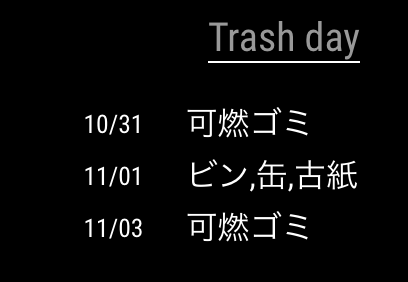

# MMM-SimpleNotifyTrashDay

Notify trash day on your MagicMirror.

## Features

Configure weekly collection days or specific weekday occurrences within each month.

## Screenshot

-`Sample screenshot 1`  


## Requirements and compatibility

Targets MagicMirror² **2.38.0**, with Node.js `>=22.22.2 <23 || >=24` (the same requirement as that release). Earlier MagicMirror versions have not been verified. The module has no runtime npm dependencies and uses the Moment.js script provided by MagicMirror for existing `timeFormat` compatibility.

## UPDATE

**1.1.0**

- Migrate source to strict TypeScript; commit generated JavaScript for direct installation.
- Render titles, labels and formatted dates as text to prevent HTML/script injection.
- Validate configuration, including invalid weekdays that previously caused an infinite loop.
- Fix cutoff minutes/seconds, missing final months, duplicate schedule entries and timer cleanup.
- Remove the unused server helper and accidental global variable in the unused API method.
- Scope CSS to this module.

**1.0.0**

- Simple viewer for notifying trash day.

**1.0.1**

- Bug fix.

**1.0.2**

- Add feature: You can specify how long you want to display the notification for the day with expiredTime.

**1.0.3**

- Bug fix.

## Installation

```sh
cd ~/MagicMirror/modules/
git clone https://github.com/sabo10o29/MMM-SimpleNotifyTrashDay.git
cd MMM-SimpleNotifyTrashDay
```

The compiled JavaScript is included; installation does not require npm or a build. Restart MagicMirror after installing or updating.

## Necessary Configuration

```javascript
{
    module: "MMM-SimpleNotifyTrashDay",
    //Positions of *_bar and *_third are not support.
    position: "top_left",
    config: {
        notify: 7,
        trashDay:[
            {
                //e.g. Notification of every Monday and Thursday burnable trash days.
                //Day of the week
                //'sun', 'mon', 'tue', 'wed', 'thu', 'fri', 'sat'
                DOW: ["mon","thu"],
                //Number of week in each month
                //If you want to notify every week, please set all number.
                NOW: [1,2,3,4,5],
                LABEL: "可燃ゴミ",
            },
            {
                //e.g. Notification of trash days on the first and third Tuesday of every month.
                DOW: ["tue"],
                NOW: [1,3],
                LABEL: "ビン,缶,古紙",
            },
        ],
	},
},
```

## Optional Configuration

| Option        | Description                                                                                                                                    |
| ------------- | ---------------------------------------------------------------------------------------------------------------------------------------------- |
| `notify`      | How many days notify in advance? <br><br>**Type:** `int` <br> **Default value:** `1`                                                           |
| `timeFormat`  | The time format of the delay info based on [moment.js](https://momentjs.com/docs/). <br><br>**Type:** `String` <br> **Default value:** `MM/DD` |
| `title`       | Title name <br><br>**Type:** `String` <br> **Default value:** `Trash day `                                                                     |
| `expiredTime` | You can specify how long you want to display the notification for the day. <br><br>**Type:** `number` <br> **Default value:** `0`             |


`expiredTime` is the local cutoff hour on the collection day, from 0 to 24 (fractional hours such as 8.5 are supported). The default 0 stops displaying that day at midnight; use 8 for 08:00 or 24 for the end of the day. The displayed date remains the collection date. A collection remains visible at the exact cutoff instant, and expires immediately afterward.

`notify` must be an integer from 0 to 3660. `trashDay` defaults to an empty array. `NOW` means the nth occurrence of each weekday within a month, not a continuous alternating-week schedule. Missing fifth weekdays are skipped. Duplicate days/weeks within one rule appear once. All dates use the mirror's local timezone.

Additional options: `updateInterval` is an integer from 1000 to 2147483647 milliseconds (default 3600000); `animationSpeed` is a non-negative number in milliseconds (default 1000). Expiration becomes visible on the next refresh; decrease the interval if greater timing precision is needed. Titles and labels now display literal text, so HTML markup in existing configuration must be removed.

## Development

Edit `src/MMM-SimpleNotifyTrashDay.ts`, then run:

```sh
npm ci
npm run check
```

Commit both TypeScript source and generated `MMM-SimpleNotifyTrashDay.js`. TypeScript 5.9.3 is pinned as the build-only JavaScript compiler; newer native TypeScript compiler versions are not adopted in this change. Runtime dependencies remain empty. The lockfile records the compiler's official npm integrity hash.

## Verification and limitations

Regression tests exercise cutoff precision, month/year boundaries, leap years, missing fifth weekdays, invalid settings, duplicate entries, safe rendering, and timer lifecycle. Type checking uses strict mode. The npm advisory API reported no advisories for the pinned compiler on 2026-11-17.

The official MagicMirror² v2.38.0 core was checked with a registration/configuration/lifecycle smoke test, with external core imports stubbed. Full Electron/Raspberry Pi rendering has not been tested; verify the display on your mirror before deployment.
